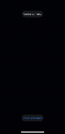

# GestureAR

**Control 3D objects in augmented reality with nothing but your hand.**

Hold up an open palm and a box appears on the table in front of you. Pinch and it grows. Make a fist and it spins. No controller, no buttons, no network connection. Everything runs on the iPhone, at about 20 frames per second.

I built this to learn Apple's on-device ML and AR stack end to end: how a camera frame becomes hand keypoints, how keypoints become a gesture, and how a gesture becomes something you can see in the room.

## What it does

| Gesture | What happens |
|---|---|
| Open palm | Spawns a 3D box on the surface the camera is pointing at |
| Pinch | Grows the box (capped at 3x) |
| Fist | Rotates the box |

The screen shows the current gesture, the live processing rate, and rolling latency numbers for each pipeline stage. A **Save snapshot** button writes the current camera frame to a PNG.

## A first look

<p align="center">
  <!-- Replace with your demo: drag a screen recording or GIF into the GitHub editor -->
  
</p>

<p align="center"><sub>Demo recording on iPhone 14.</sub></p>

## How it works

```
ARKit camera frame
   -> Vision hand pose (21 joint keypoints)
   -> Core ML classifier (open palm / pinch / fist)
   -> confidence threshold + debounce
   -> RealityKit entity (spawn / scale / rotate)
```

1. **ARKit** delivers camera frames and world tracking, and raycasts against detected surfaces so the box lands on something real. If no surface is found yet, it falls back to placing the box 40 cm in front of the camera.
2. **Vision** (`VNDetectHumanHandPoseRequest`) finds the hand and returns its joint positions. Every third frame is processed.
3. **Core ML** runs my own **Create ML hand-pose classifier** on those keypoints. Because it learns from joint positions rather than raw pixels, it needs far less data and works at different distances.
4. **Filtering.** Predictions below 0.85 confidence count as "no gesture". A gesture must hold for 4 frames to engage and is released after 2 frames without it, so one noisy frame never triggers anything and letting go feels immediate.
5. **RealityKit** turns the stable gesture into motion.

## Performance

Measured on-device and shown live on screen (iPhone 14, iOS 27.0.1, `computeUnits = .all`, `<Release or Debug>` build). Each figure comes from a rolling 100-frame window.

| Stage | Median | p95 |
|---|---|---|
| Vision hand pose | 12.6 ms | 17.8 ms |
| Core ML classifier | 1.6 ms | 2.5 ms |

- **Delivered rate: about 20 fps.** The app processes every 3rd frame of a 60 fps camera feed, so the rate is set by that choice rather than by compute. A processed frame takes roughly 14 ms against a 50 ms budget, which leaves room to process more often.
- **Vision is the bottleneck.** Hand-pose extraction accounts for about 89% of per-frame time. The custom classifier is the small part.
- **What the numbers cover.** The Core ML time is the `prediction` call alone (keypoint extraction excluded) and only counts frames where a hand was found. Memory and power have not been profiled.

## The model

I collected the training images myself with a small webcam script (`tools/capture.py`) and trained the classifier in Create ML with rotate, translate and scale augmentation.

It was evaluated on a separate test set recorded in a different session (812 frames, same person and webcam):

| Gesture | Precision | Recall |
|---|---|---|
| Fist | 98% | 93% |
| Pinch | 88% | 98% |
| Open palm | 92% | 66% |

Macro F1 is **0.89**.

### The part I learned the most from

My first version had a fourth class, `none`, for "any other hand pose". It performed worse with every retrain. Looking at the per-class table, the confusion was clear: my `none` examples (relaxed hands, half-curled fingers) looked almost exactly like open palms and fists, so the classifier couldn't separate them.

The fix was to stop teaching the model what "nothing" looks like. I went back to three classes and let the app decide on "none" itself: no hand detected, confidence under 0.85, or a gesture that hasn't held long enough. Precision and recall recovered right away.

## Core Foundation and Core Video utilities

`PixelBufferUtils.swift` collects the low-level pieces I needed for working with camera frames:

- creating `CVPixelBuffer`s from `CFDictionary` attributes
- locking buffers and copying planar (YCbCr) frames plane by plane
- cropping and converting frames to BGRA
- saving PNG snapshots with ImageIO (`CGImageDestination` writing into a `CFMutableData`) and reading the metadata back with `CGImageSource`

## The honest part

- **One person's hand.** The classifier was trained and tested on a single user, so accuracy for other people will likely be lower.
- **One hand at a time.**
- **Open palm recall is the weak spot** (66%). Pinch is sometimes predicted when the thumb is close to the index finger. More varied open-palm data would help.
- **Partly profiled.** Latency and frame rate are measured (see Performance). Memory, power and thermal behavior are not.
- **Camera and the debugger.** On my setup (iOS 27 and Xcode 27), the camera preview stayed blank while Xcode was attached. Running the app unattached from the Home Screen works normally.

## What's next

- Record more varied training data (more users, lighting and backgrounds) and retrain
- Profile memory and power with Instruments, and compare compute units
- Try processing every 2nd frame for a higher rate, now that there's latency headroom
- Two-hand gestures
- More gestures, such as thumbs up and pointing

## Run it yourself

You need a physical iPhone with ARKit support and Xcode 27. The simulator has no camera or AR.

1. Clone the repo and open `GestureAR.xcodeproj`.
2. Under **Signing & Capabilities**, choose your own team.
3. Select your iPhone and press **Run**.
4. If the camera is blank, stop the session in Xcode and open GestureAR from the Home Screen instead.
5. Move the phone slowly over a textured table or floor for a few seconds so a surface is detected, then show an open palm.

To get representative timing numbers, use a Release build (Product → Scheme → Edit Scheme → Run → Build Configuration).

## Training your own classifier

`tools/capture.py` records labeled frames from your webcam:

```bash
pip3 install opencv-python
python3 tools/capture.py openPalm   # space = start/stop recording, q = quit
```

Record `openPalm`, `fist` and `pinch` into `data/<label>/`, then train a Hand Pose Classifier in Create ML and replace `GestureClassifier.mlmodel`. The class names must match the `Gesture` enum in `ContentView.swift`.

## Tech

Swift, SwiftUI, ARKit, RealityKit, Vision, Core ML, Create ML, Core Video, Core Foundation, ImageIO, XCTest.

---

Built by Reshma Merin Thomas.
